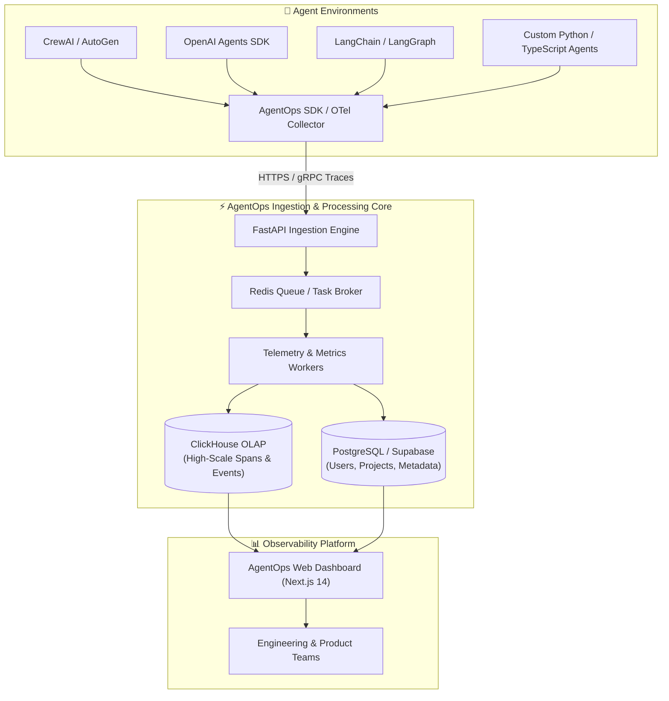

<div align="center">

# 🤖 AgentOps Platform
### *Enterprise-Grade Observability, Session Replay & Monitoring for Autonomous AI Agents*

[](https://pypi.org/project/agentops/)
[](https://www.python.org/)
[](https://nextjs.org/)
[](https://fastapi.tiangolo.com/)
[](https://opentelemetry.io/)
[](LICENSE)
[](CONTRIBUTING.md)

<p align="center">
  <a href="#-overview">Overview</a> •
  <a href="#-core-capabilities">Key Features</a> •
  <a href="#-system-architecture">Architecture</a> •
  <a href="#-quick-start-sdk">Quick Start</a> •
  <a href="#-framework-integrations">Integrations</a> •
  <a href="#-self-hosting--platform-deployment">Self-Hosting</a> •
  <a href="#-security--privacy">Security</a> •
  <a href="#-repository-structure">Repository Structure</a>
</p>

---

</div>

## 📌 Overview

Building autonomous AI agents is hard; debugging and operating them in production is even harder. Agents exhibit non-deterministic behavior, call tools dynamically, incur variable token costs, and can fall into costly infinite loops or reasoning traps.

**AgentOps** is the unified observability, testing, and monitoring platform built specifically for AI agents and LLM applications. From local prototyping to mission-critical enterprise production, AgentOps equips developers with step-by-step session replays, hierarchical event tracking, cost attribution, and real-time failure detection.

```python
import agentops

# Initialize AgentOps in 2 lines of code
agentops.init(api_key="<YOUR_AGENTOPS_API_KEY>")

# ... Run your Agent / Workflow ...

agentops.end_session("Success")
```

---

## ✨ Core Capabilities

| Capability | Description |
| :--- | :--- |
| 🔄 **Deterministic Session Replays** | Visual step-by-step execution trees showing agent thought cycles, tool invocations, prompts, outputs, and latencies. |
| 💸 **Granular Cost & Token Analytics** | Real-time spend attribution across 100+ LLMs (OpenAI, Anthropic, Gemini, Mistral, Groq, Cohere, Llama 3, and self-hosted models). |
| 🤝 **Multi-Agent Orchestration** | Native tracing for agent-to-agent delegation, handoffs, consensus protocols, and conversational turns. |
| 🛡️ **Autonomous Failure Detection** | Automatic recognition of infinite recursion, faulty reasoning loops, token limit overflows, and tool execution crashes. |
| 🔌 **OpenTelemetry (OTel) Native** | Built upon standardized GenAI semantic conventions with zero vendor lock-in. |
| 🖥️ **Full-Stack Self-Hostable** | Includes complete web dashboard (Next.js 14) and high-throughput ingestion backend (FastAPI + ClickHouse + Supabase). |

---

## 🏛️ System Architecture



---

## 🚀 Quick Start: Python SDK

### 1. Installation

Install the core AgentOps package via `pip` or `uv`:

```bash
pip install agentops
```

For specific framework integrations:
```bash
pip install "agentops[crewai]"       # CrewAI integration
pip install "agentops[langchain]"    # LangChain integration
pip install "agentops[autogen]"      # AutoGen / AG2 integration
```

### 2. Basic Session Tracking

Set your API key via environment variable:
```bash
export AGENTOPS_API_KEY="your-agentops-api-key"
```

Then initialize AgentOps at the entrypoint of your application:
```python
import os
import agentops

# Initialize AgentOps
agentops.init(
    api_key=os.getenv("AGENTOPS_API_KEY"),
    tags=["production", "customer-support-agent"],
    auto_start_session=True
)

# Your agent code runs here ...

# Complete session
agentops.end_session(end_state="Success")  # Options: "Success", "Fail", "Indeterminate"
```

### 3. Granular Decorators

AgentOps offers declarative decorators for precise hierarchy mapping:

```python
from agentops.sdk.decorators import session, agent, operation, task

@agent(name="ResearchAnalyst")
class ResearchAgent:
    @task(name="fetch_market_data")
    def fetch_data(self, ticker: str):
        # Automatically tracks inputs, outputs, exceptions, and latency
        return {"ticker": ticker, "price": 182.50}

    @operation(name="synthesize_report")
    def create_report(self, data: dict):
        return f"Report summary for {data['ticker']}"

@session(name="DailyMarketBriefing")
def run_workflow():
    bot = ResearchAgent()
    data = bot.fetch_data("NVDA")
    return bot.create_report(data)

if __name__ == "__main__":
    run_workflow()
```

---

## 🔌 Framework Integrations

AgentOps provides out-of-the-box support for the modern AI agent stack:

<details>
<summary><b>1. OpenAI Agents SDK</b></summary>

```python
from agents import Agent, Runner
import agentops

agentops.init()

agent = Agent(
    name="Triage Assistant",
    instructions="You are a helpful triage agent."
)

result = Runner.run_sync(agent, "Summarize user ticket #1049")
print(result.final_output)

agentops.end_session("Success")
```
</details>

<details>
<summary><b>2. CrewAI</b></summary>

```python
import os
import agentops
from crewai import Agent, Task, Crew

agentops.init(api_key=os.getenv("AGENTOPS_API_KEY"))

researcher = Agent(
    role="Senior Research Analyst",
    goal="Uncover cutting-edge developments in AI",
    backstory="You are an expert researcher with a keen eye for tech trends.",
    verbose=True
)

task = Task(
    description="Analyze latest breakthroughs in Agentic LLMs for 2026",
    expected_output="A bulleted 3-paragraph executive summary",
    agent=researcher
)

crew = Crew(agents=[researcher], tasks=[task], verbose=True)
result = crew.kickoff()

agentops.end_session("Success")
```
</details>

<details>
<summary><b>3. AG2 (Formerly AutoGen)</b></summary>

```python
import os
import agentops
from autogen import ConversableAgent

agentops.init(api_key=os.getenv("AGENTOPS_API_KEY"))

assistant = ConversableAgent(
    name="assistant",
    llm_config={"config_list": [{"model": "gpt-4o", "api_key": os.environ["OPENAI_API_KEY"]}]},
)
user_proxy = ConversableAgent(
    name="user_proxy",
    human_input_mode="NEVER",
    max_consecutive_auto_reply=1,
)

user_proxy.initiate_chat(assistant, message="Draft a concise value proposition for AgentOps.")
agentops.end_session("Success")
```
</details>

<details>
<summary><b>4. LangChain & LangGraph</b></summary>

```python
import os
from langchain_openai import ChatOpenAI
from agentops.integration.callbacks.langchain import LangchainCallbackHandler

handler = LangchainCallbackHandler(
    api_key=os.getenv("AGENTOPS_API_KEY"),
    tags=["langchain-pipeline"]
)

llm = ChatOpenAI(model="gpt-4o", callbacks=[handler])
response = llm.invoke("What are the key pillars of LLM observability?")
print(response.content)
```
</details>

<details>
<summary><b>5. LlamaIndex</b></summary>

```python
from llama_index.core import set_global_handler
import agentops

agentops.init()
set_global_handler("agentops")

# Queries executed through LlamaIndex query engines are tracked automatically
```
</details>

---

## 🛠️ Self-Hosting & Platform Deployment

You can self-host the complete AgentOps platform (FastAPI backend + Next.js dashboard + ClickHouse) within your own cloud or on-prem environment.

### Prerequisites
- Docker & Docker Compose
- Python 3.10+
- Node.js 18+ and pnpm / npm

### Architecture Components
- **Dashboard (`app/dashboard`)**: Next.js 14 frontend with Tailwind CSS, Lucide icons, and real-time visualization.
- **API Backend (`app/api`)**: High-throughput FastAPI service processing spans, sessions, and telemetry events.
- **Data Layer**: ClickHouse for high-velocity trace OLAP; Supabase/PostgreSQL for relational project configuration and authentication.

### Local Development Setup

#### 1. Configure Environment Variables
Copy template environment files (these templates contain zero sensitive keys):
```bash
cp app/.env.example app/.env
cp app/dashboard/.env.example app/dashboard/.env.local
```

#### 2. Start the Backend API
```bash
cd app
python -m venv .venv
source .venv/bin/activate  # On Windows: .venv\Scripts\activate
pip install -r requirements.txt
uvicorn api.main:app --host 0.0.0.0 --port 8000 --reload
```

#### 3. Start the Web Dashboard
```bash
cd app/dashboard
npm install
npm run dev
```

Visit [http://localhost:3000](http://localhost:3000) to open the AgentOps web interface.

---

## 🔒 Security & Privacy

AgentOps is engineered with security and enterprise compliance as core principles:

- **Zero Secret Exposure**: Pre-commit filters and comprehensive `.gitignore` rules prevent credentials, environment files, and private keys from entering version control.
- **Configurable PII Redaction**: Scrub sensitive user data, emails, and credentials locally on the client before telemetry transmission.
- **VPC / On-Premises Isolation**: Self-host the full data pipeline to keep all LLM prompts, completions, and trace telemetry inside your secure network.
- **Role-Based Access Control (RBAC)**: Manage multi-tenant organizations, project keys, and member permissions securely.

---

## 📂 Repository Structure

```
├── agentops/              # Core Python SDK source code & instrumentation
│   ├── client.py          # Primary AgentOps client interface
│   ├── semconv/           # OpenTelemetry semantic conventions for GenAI
│   ├── instrumentation/   # Auto-instrumentation hooks (OpenAI, Anthropic, LiteLLM, etc.)
│   └── sdk/               # Decorators (@session, @agent, @task, @workflow)
│
├── app/                   # Full-Stack Platform Source
│   ├── api/               # FastAPI backend ingestion & management endpoints
│   ├── dashboard/         # Next.js 14 web console and analytics dashboard
│   ├── deploy/            # Deployment orchestration and worker services
│   └── supabase/          # Database schemas, migrations, and seed scripts
│
├── docs/                  # Documentation source, guides, and architecture assets
├── examples/              # Ready-to-run Jupyter notebooks and reference scripts
├── tests/                 # Unit, integration, and E2E test suites
├── pyproject.toml         # Python build configuration and dependencies
└── uv.lock                # Deterministic dependency lockfile
```

---

## 🧪 Testing

Run the test suite to verify the SDK and platform:

```bash
# Run unit tests
pytest tests/unit

# Run integration tests
pytest tests/integration
```

---

## 🤝 Contributing

We welcome contributions from the open-source community! 

1. Fork this repository.
2. Create your feature branch (`git checkout -b feature/amazing-feature`).
3. Commit your changes with clear, descriptive messages (`git commit -m 'feat: add telemetry support for XYZ'`).
4. Push to your branch (`git push origin feature/amazing-feature`).
5. Open a Pull Request.

Please review [CONTRIBUTING.md](CONTRIBUTING.md) for full development standards and guidelines.

---

## 📜 License

This project is licensed under the MIT License — see the [LICENSE](LICENSE) file for details.

<div align="center">
  <sub>Built with ❤️ for the AI Agent & LLM Developer Community</sub>
</div>
